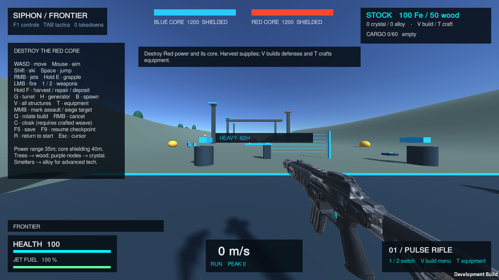
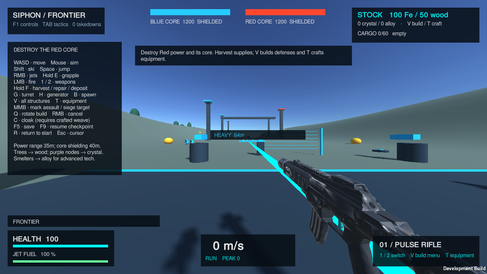
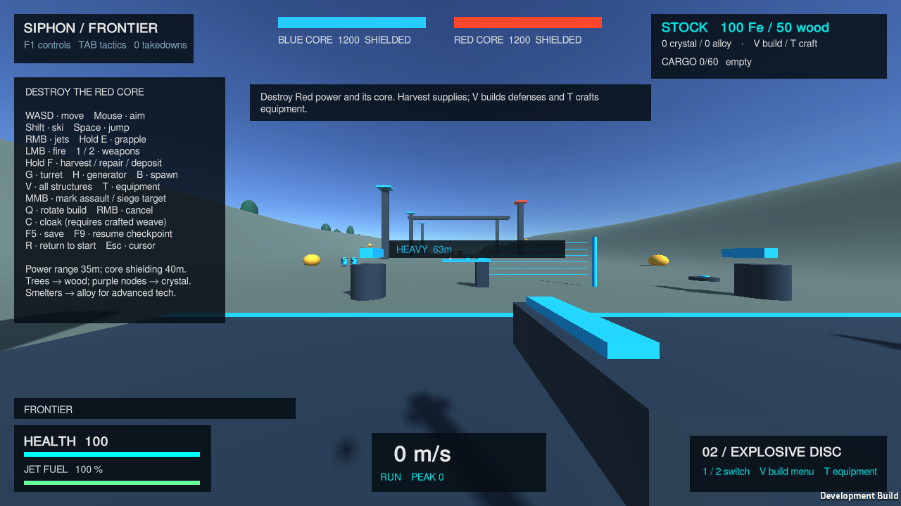

# Siphon development updates

Screenshots, showcases and concise briefings live here in the repository so they can be viewed directly on GitHub. Images below come from actual game builds; plans are labeled separately.

[Roadmap](ROADMAP.md) · [Latest briefing](docs/briefings/LATEST.md) · [Development workflow](docs/WORKFLOW.md)

## Latest development — map layout foundation

The 600m map now shares its size, anchors and bounds across terrain, navigation, HUD and save recovery. This prepares the proposed larger map; the playable area has not expanded. [Briefing](docs/briefings/2026-11-15-layout.md) · [Terrain dependency audit](docs/maps/M01-PLAN.md)

## Latest playable showcase — first generated pulse rifle

The first generated rifle is in game: a 0.8m prefab with 7553 triangles and 2K URP materials. It survives scene rebuilds and preserves accepted movement and weapon balance. The style is provisional; hand/equip animation and a world model are still to come.

Source: `1cc509d` · Linux candidate: `Builds/SiphonCandidate/Siphon.x86_64` (local build; no downloadable release published). Candidate build, 25-second smoke, weapon switching/firing, focused Stalker validation and separate review passed. [Full briefing](docs/briefings/2026-11-15-rifle.md) · [Generation provenance and checks](docs/assets/PULSE-RIFLE.md)

See firing and weapon switching

Rifle firing and recoil remain connected to the existing combat system.

Switching to the disc keeps its current placeholder while the new rifle is hidden.

## Briefing archive

| Update | What changed | Evidence |
| --- | --- | --- |
| [2026-11-15 — Paired review-tool trial](docs/reviews/README.md) | PR-Agent and Alibaba OpenCodeReview; separate outputs for later audit | Hosted trial evidence and coverage limits; no gameplay change |
| [2026-11-15 — Map layout foundation](docs/briefings/2026-11-15-layout.md) | Shared current layout and GitHub update pages; larger map still planned | Generation/runtime/field checks and new candidate smoke passed |
| [2026-11-15 — First generated rifle](docs/briefings/2026-11-15-rifle.md) | First-person model, URP materials, persistent prefab; Stalker initialization and validator fixes | Actual-build screenshots and passing checks |
| [2026-11-15 — Independent review and memory audit](docs/briefings/2026-11-15-review.md) | Separate reviewer role, PR-Agent fixes; mem0 deferred | Configuration checks and independent review; no game build |
| [2026-11-15 — Roadmap and workflow](docs/briefings/2026-11-15.md) | Priorities, compact handoff and asset pipeline | Setup evidence; no new gameplay build |

## Next

Terrain planning for the provisional 2km × 2km map. Plans and calculations are not screenshots or performance measurements of a larger playable build. See the roadmap for current status.
