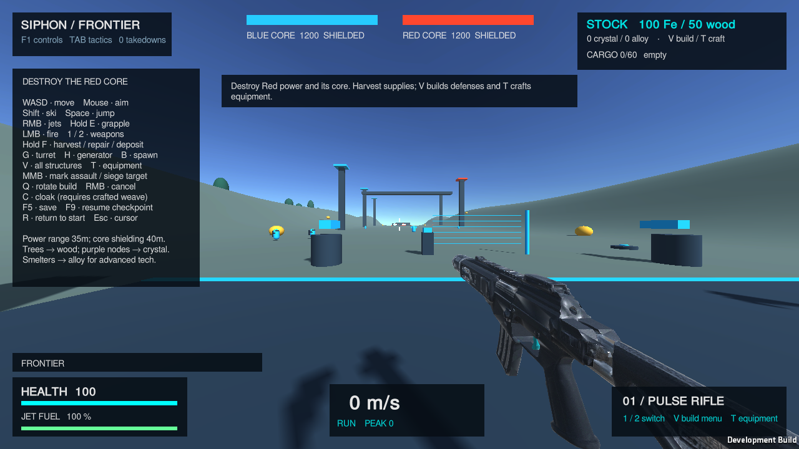

# Isolated map candidate — 2026-11-15

[All updates & showcases](../../UPDATES.md)

The map experiment now has its own scene, generated terrain/navigation assets, Linux build output and checkpoint identity. It is still a **600m clone** of the accepted field. This lets the next terrain experiment change geometry without overwriting the baseline or mixing its saves. Movement, weapon balance and the quiet movement lab remain unchanged.

Legacy checkpoints without a layout identity remain readable on the default map. New v4 checkpoints carry identity; cross-layout primary/backup restores reject before changing the world. Candidate F9 and restart use an editor-safe scene reload and were exercised through actual scene transitions. A changed geometry candidate must get a new identity.

Verification passed: candidate generation left all existing Siphon source asset bytes unchanged; separate mesh/navigation references and accepted rifle/movement references checked. Runtime checks covered legacy restore, cross-layout rejection, checkpoint/backup recovery, F9 load and fresh restart. Default FieldValidation passed. The isolated Linux build and rendered 25-second smoke passed: 19 bots, four worker deliveries, 153 navigation searches and zero failures, plus weapon switching/firing/recoil. Separate implementation and independent review completed; both hosted reviewers completed on [PR #3](https://github.com/Jbudone/siphon/pull/3), now merged. OCR completed seven selected C# files with zero findings; PR-Agent reported no major issues with a pruned diff. [Audit evidence](../reviews/trial-003.md).

Candidate: `Builds/SiphonMapCandidate600/Siphon.x86_64`, Unity 6000.6.0f1, source base `b6f71c1` plus this slice. [Build provenance](../maps/M01-CANDIDATE-BUILD.json) · [Exact checks and limitations](../maps/M01-CANDIDATE-CHECKS.md). No downloadable release published. The full movement validator was not rerun. Xvfb/llvmpipe capture is not representative performance evidence.

Next: expand the isolated experiment with a new layout/save identity, deliberate terrain/content placement, then measure seams, routes, recovery and navigation performance. The proposed 2km dimensions remain provisional.
