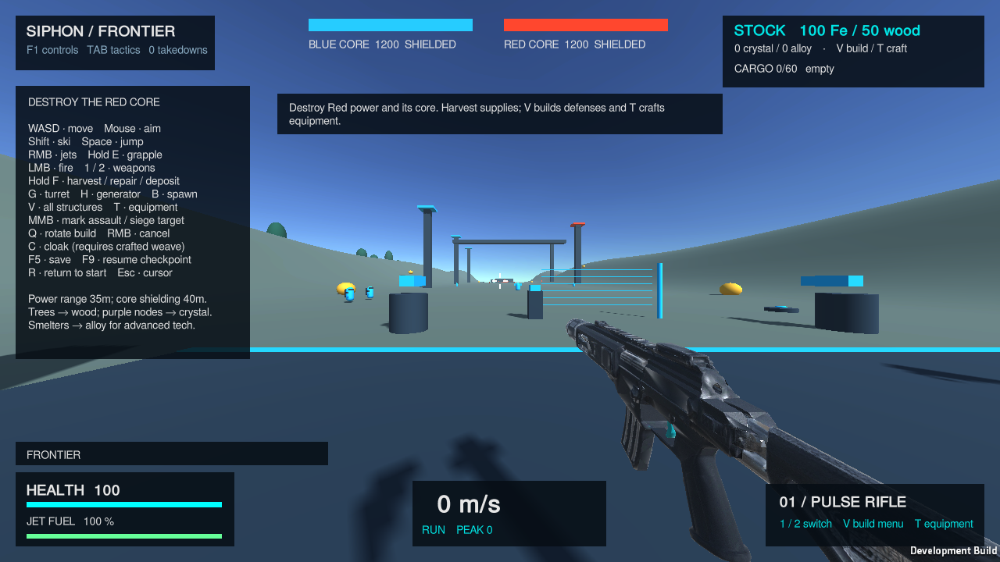

# Map layout foundation and GitHub update pages — 2026-11-15

[All updates & showcases](../../UPDATES.md)

The current 600m assault layout now has a shared definition for terrain extent, navigation density, base/spawn/camp anchors, HUD projection and recovery/save bounds. This removes conflicting size assumptions before creating the provisional 2km map. The playable area, accepted movement, weapons, save schema and movement lab remain the baseline. [Dependency audit and proposed expansion budget](../maps/M01-PLAN.md).

README links to the repository's screenshot showcase and briefing archive. Actual-build screenshots use relative links and regular Git storage so they render directly on GitHub after push. Existing dated briefings link back to the showcase. Plans are labeled separately from playable builds; no GitHub Pages deployment or downloadable release is implied.

Verification: generation/reload checks passed for terrain topology/extent, navigation coverage, anchors, rifle prefab and HUD projection. Runtime checks passed at and just beyond all four target/bot recovery edges (295m) and saved-player edges (290m). Fresh independent Sol review found no actionable correctness findings. Existing FieldValidation passed, including legacy version 1 save readability/atomic recovery and navigation/economy/respawn checks. The new Linux candidate build and 25-second standalone smoke exited 0; 19 bots,4 worker deliveries,145 navigation searches/0 failures, rifle/disc switching and firing/recoil passed. The movement lab and tuning files were not changed; its full movement validator was not rerun. These checks do not establish large-map reachability or performance.

Candidate: `Builds/SiphonCandidate/Siphon.x86_64`, Unity 6000.6.0f1, source base `1cc509d` plus this layout slice. [Named build input/output hashes](../maps/M01-BUILD.json) include the managed runtime assembly and serialized scene. Exact commands/results are in CURRENT-TASK. Existing `Builds/Siphon` remains untouched.

This screenshot verifies the existing scene and rifle after the layout change; it is not a screenshot of a 2km map.

Unity access was initially misreported unavailable because the environment contained CLI beta.8. Restoring stable 1.0.0 made the required login/Cloud check pass. No new credentials, paid generations or user login were needed.

Next: create an opt-in larger-map candidate with separate generated geometry/navigation and save identity, then measure routes, recovery events and performance. The proposed dimensions, tile budget and travel times in the audit are estimates, not results from a larger playable build. Publication destination selected: public [Jbudone/siphon](https://github.com/Jbudone/siphon). Briefings and screenshots are published with the repository; PR-Agent hosted review still needs its Actions secret.
