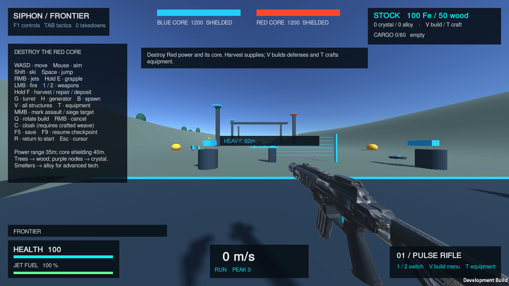

# First generated rifle in game — 2026-11-15

[All updates & showcases](../../UPDATES.md)

The pulse rifle now has an imported 7553-triangle model, 2K URP materials and a reusable 0.8m prefab that survives assault scene regeneration. Rifle/disc selection and existing recoil work; combat damage, cadence, firing origin and accepted movement remain unchanged. The disc keeps its placeholder.

Candidate: `Builds/SiphonCandidate/Siphon.x86_64`; the existing `Builds/Siphon` was not replaced. Built from `d8d735e` plus this committed slice. [Build input and executable hashes](../assets/pulse-rifle-build.json) identify the tested source and artifact. Explicit Siphon batch path used; the Yendor bridge was not mutated.

Checks passed: candidate build, rebuilt-scene prefab/scale/material/collision checks, 25-second standalone smoke, automated visual weapon selection and rifle firing/recoil, actual screenshot inspection, focused Stalker validator, and independent separate Sol review with no actionable findings. The initial smoke caught a pre-existing Stalker native allocation in a field initializer; moving it to Awake removed exceptions. The Stalker test also needed its target collider restored after teleport; its final isolated run passed with four pounces/four bites. These are specific checks, not full Q01 reconciliation or a performance benchmark.

Meshy `meshy-7.1`: preview `01a1e181-2bca-751e-9815-3fb18f1e17fd`, refine `01a1e182-185a-7182-8f86-e2a18314e377`; 30 credits observed, 1870 remain. Both outputs downloaded, no jobs in flight. [Asset record, prompts and provenance](../assets/PULSE-RIFLE.md). Git LFS stores binary art. Fresh implementation worker creation hit the platform thread limit, so the orchestrator performed this slice directly; the separate reviewer inspected it.

Style remains provisional: generated pseudo markings, no authored hands/equip animation or world weapon yet. G01 owns those follow-ups. No human feedback requested. Hosted PR-Agent still awaits a GitHub destination and Actions secret.
